<div align="center">

# 🎼 Swaralipi Lab

### Read handwritten Indian Classical music notation in seconds

Upload or photograph a handwritten *swaralipi* manuscript, crop a region, and get every swara identified in Devanagari, with confidence scores, exportable notation and a persistent scan archive.


</div>

---

## Table of Contents

- [Overview](#overview)
- [Screenshots](#screenshots)
- [Features](#features)
- [System Architecture](#system-architecture)
- [Detection Pipeline](#detection-pipeline)
- [Request Flow](#request-flow)
- [Supported Swaras](#supported-swaras)
- [Model Training and Performance](#model-training-and-performance)
- [Project Structure](#project-structure)
- [Getting Started](#getting-started)
- [Configuration](#configuration)
- [API Reference](#api-reference)
- [Deployment](#deployment)
- [Design Decisions](#design-decisions)
- [Limitations](#limitations)
- [Roadmap](#roadmap)
- [Tech Stack](#tech-stack)
- [License](#license)

---

## Overview

Hindustani classical music is written down in *swaralipi*, a notation built from Devanagari letters (सा रे ग म प ध नि) with small marks for *komal* (flat) and *tivra* (sharp) notes. Most of it still lives on paper, written by hand. **Swaralipi Lab** digitises that handwriting.

A custom-trained **YOLOv8** detector finds each symbol. A post-processing stage built from **template matching** and **geometric shape analysis** then resolves the symbols the detector tends to confuse, such as Ma, Pa and Tivra Ma. The result is returned as structured JSON and can be exported to **PDF, MusicXML or plain text**. The app can also import MusicXML and convert Western pitches to swaras.

---

## Screenshots

<table>
  <tr>
    <td width="50%">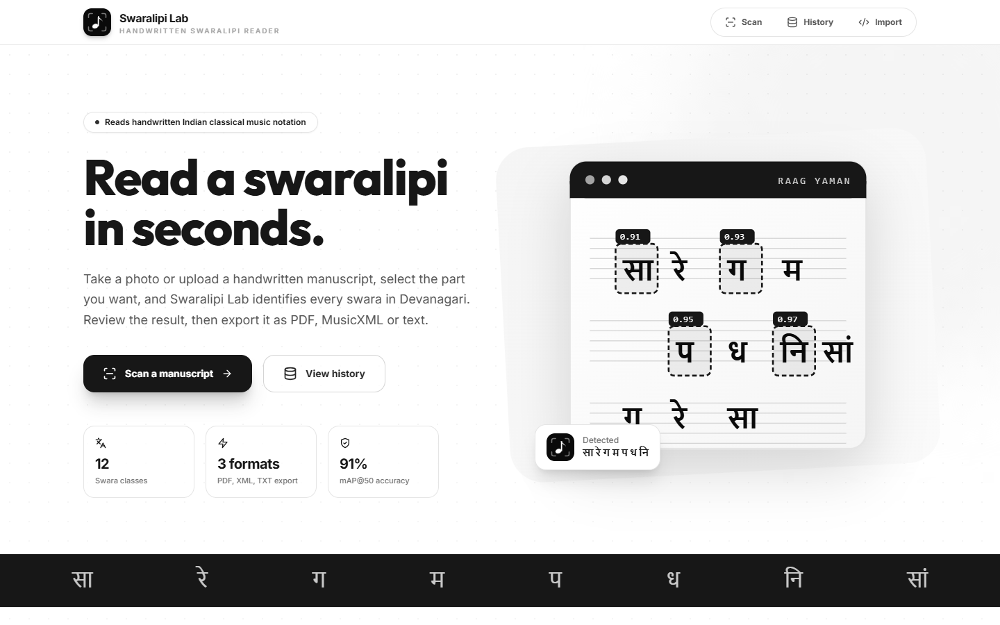<p align="center"><b>Home</b>: what the app does, at a glance</p></td>
    <td width="50%">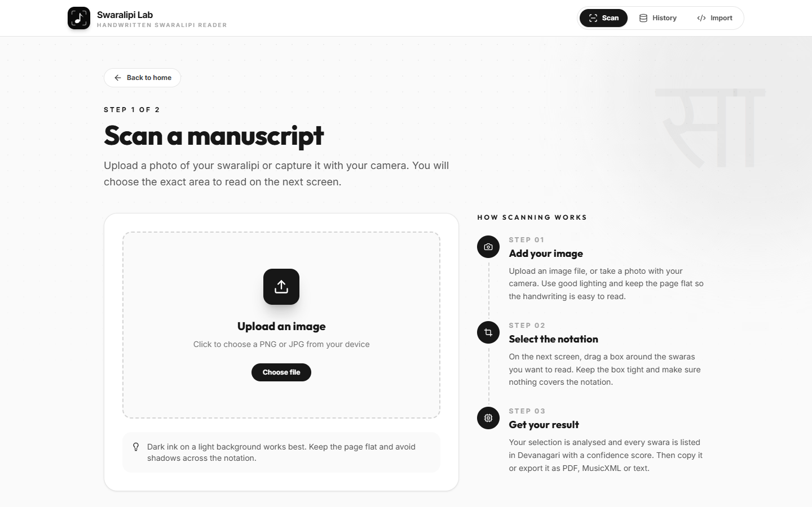<p align="center"><b>Scan</b>: upload a photo or use the camera</p></td>
  </tr>
  <tr>
    <td width="50%">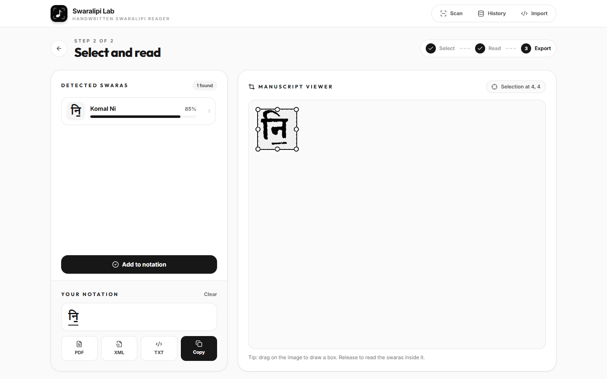<p align="center"><b>Result</b>: select a region, get the swara and confidence, then export</p></td>
    <td width="50%">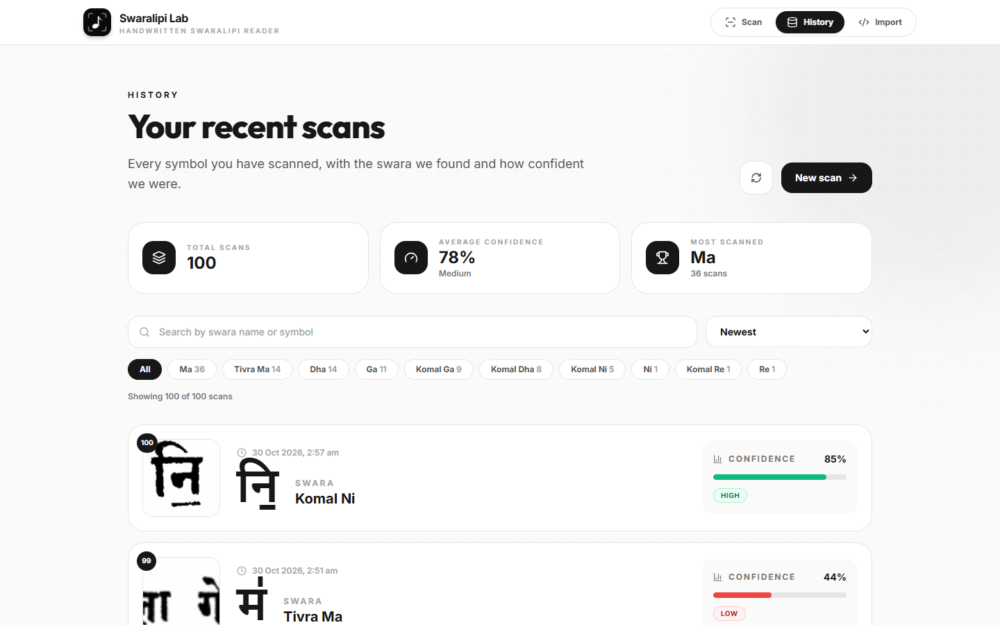<p align="center"><b>History</b>: stats, search, swara filters and color-coded confidence</p></td>
  </tr>
  <tr>
    <td width="50%">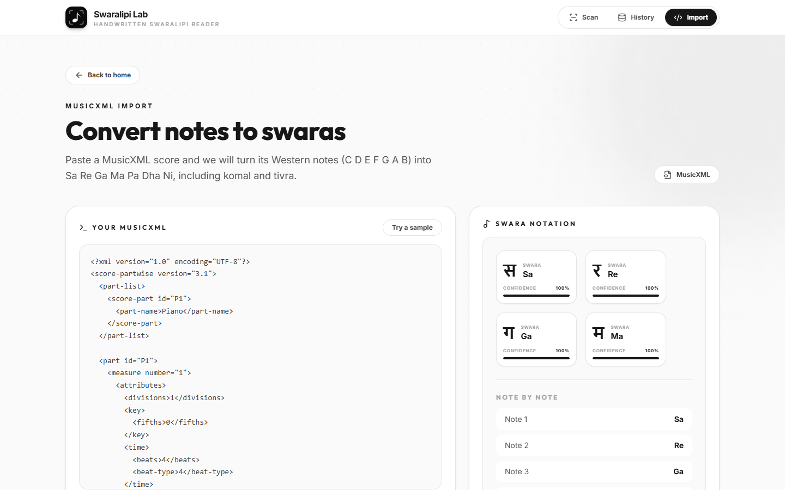<p align="center"><b>Import</b>: convert MusicXML to swaras</p></td>
    <td width="50%"></td>
  </tr>
</table>

### Model outputs

<table>
  <tr>
    <td width="50%">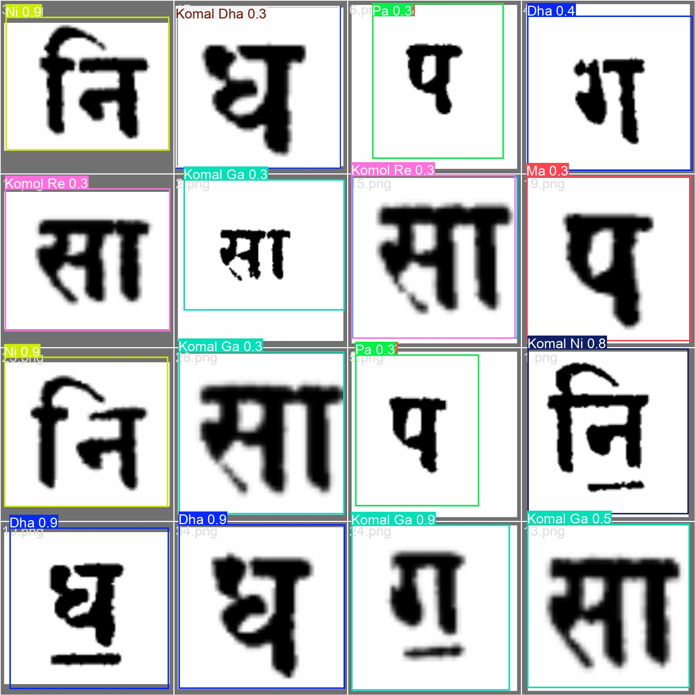<p align="center"><b>Predictions</b> on held-out validation images</p></td>
    <td width="50%">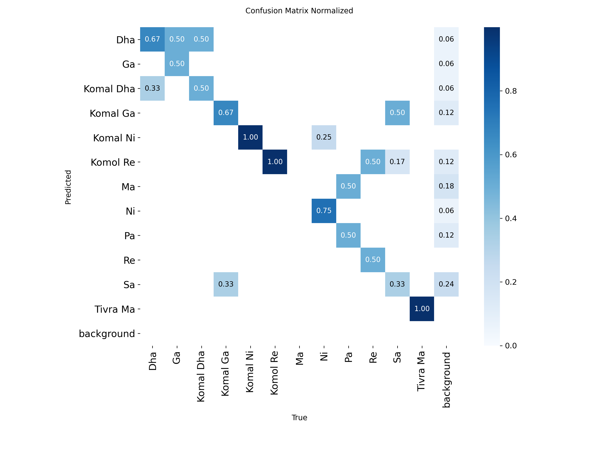<p align="center"><b>Normalised confusion matrix</b></p></td>
  </tr>
</table>

---

## Features

| | Feature | Description |
|---|---|---|
| 🔍 | **12-class swara detection** | Shuddha, Komal and Tivra variants detected with bounding boxes and confidence |
| ✂️ | **Interactive ROI cropping** | Drag a box over the exact region to analyse (`react-image-crop`) |
| 📷 | **Camera or file input** | Works with a webcam or phone camera as well as uploaded PNGs |
| 🧠 | **Multi-stage inference** | YOLOv8, then template-bank refinement, then shape analysis, then deduplication |
| 📏 | **Wide-row handling** | Long rows are segmented into symbols and processed individually |
| ┃ | **Taal vibhag detection** | Vertical bar separators are detected geometrically |
| ⚠️ | **Uncertainty warnings** | The API flags results where the top two candidates are within 10 percentage points |
| 📤 | **Export** | PDF (print view), MusicXML and plain text |
| 📥 | **MusicXML import** | Western C D E F G A B converted to Sa Re Ga Ma Pa Dha Ni, with komal/tivra from accidentals |
| 🗂️ | **Scan history** | The 100 most recent scans are kept in SQLite with image crops, with search, swara filters, sorting and a confidence summary |
| 📱 | **Responsive** | Usable on phones, with camera capture |

---

## System Architecture

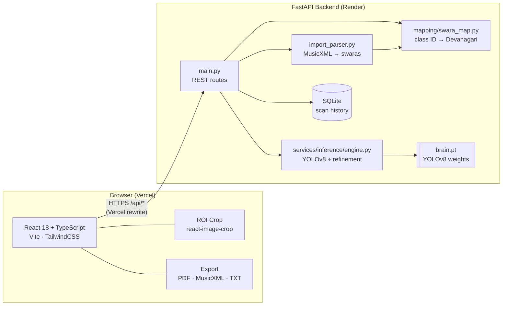

---

## Detection Pipeline

Every request to `/analyze` goes through the following pipeline in [`engine.py`](backend/app/services/inference/engine.py).

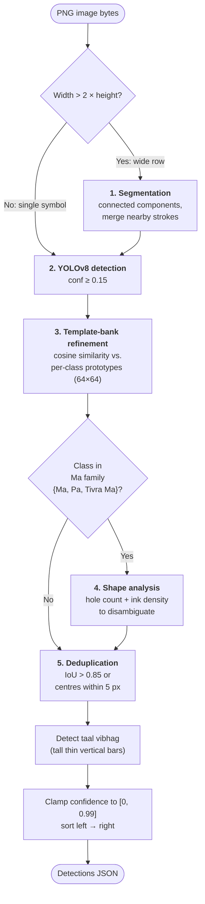

| Stage | Purpose | Method |
|---|---|---|
| **1. Segmentation** | Split wide rows into individual symbols | Connected-component analysis, merging close components |
| **2. Detection** | Locate and classify swaras | YOLOv8 at 640 px (higher resolution for wide rows) |
| **3. Template refinement** | Second opinion on confusable classes | Cosine similarity against class prototypes built from the training set |
| **4. Shape analysis** | Separate Ma, Pa and Tivra Ma | Enclosed-hole detection and density features |
| **5. Deduplication** | Remove overlapping boxes | IoU threshold plus centre-proximity check |

---

## Request Flow

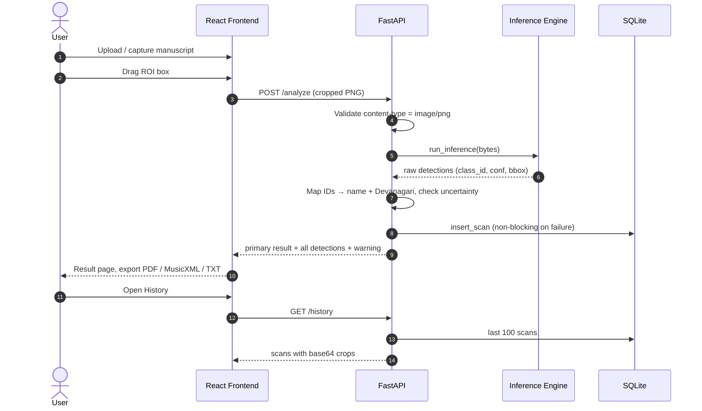

---

## Supported Swaras

The model recognises 12 classes. Class order matches [`data.yaml`](ml/data.yaml).

| ID | Swara | Symbol | ID | Swara | Symbol |
|:-:|---|:-:|:-:|---|:-:|
| 0 | Dha | ध | 6 | Ma | म |
| 1 | Ga | ग | 7 | Ni | नि |
| 2 | Komal Dha | ध॒ | 8 | Pa | प |
| 3 | Komal Ga | ग॒ | 9 | Re | र |
| 4 | Komal Ni | नि॒ | 10 | Sa | स |
| 5 | Komal Re | र॒ | 11 | Tivra Ma | म॑ |

Komal notes are written with an anudatta (॒, line below) and tivra notes with an udatta (॑, mark above). The API also returns `class_id: -1` for **Taal Vibhag** (`|`) separators.

---

## Model Training and Performance

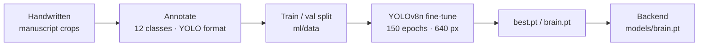

Training uses augmentation tuned for a small dataset: HSV jitter, ±15° rotation, translation, scale and shear, mosaic and light mixup. **Horizontal flip is disabled** because notation can be directional. See [`train.py`](ml/train.py).

Final-epoch validation metrics from [`results.csv`](ml/runs/swara_recognition_150_epochs/results.csv):

| Metric | Value |
|---|:-:|
| Precision | **0.818** |
| Recall | **0.770** |
| mAP@50 | **0.909** |
| mAP@50-95 | **0.806** |

The dataset is small (roughly 80 training and 74 validation images), so expect lower accuracy on handwriting styles that differ from the training data. All curves and batches are in [`ml/runs/swara_recognition_150_epochs/`](ml/runs/swara_recognition_150_epochs/).

<p align="center">
  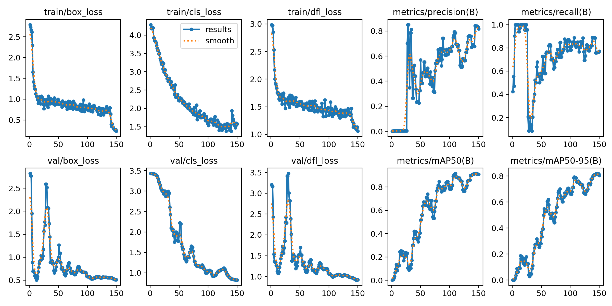
</p>

---

## Project Structure

```text
swaralipi-lab/
├── backend/                        # FastAPI service (deployed to Render)
│   ├── app/
│   │   ├── main.py                 #   REST routes (thin controllers)
│   │   ├── database.py             #   SQLite persistence
│   │   ├── mapping/swara_map.py    #   class ID → name / Devanagari
│   │   └── services/
│   │       ├── inference/engine.py #   YOLOv8 + multi-stage refinement
│   │       └── import_parser.py    #   MusicXML → swara conversion
│   ├── models/brain.pt             #   trained weights served by the API
│   ├── tests/                      #   pytest suite
│   ├── requirements.txt · requirements-dev.txt · runtime.txt
│   └── .env.example
├── frontend/                       # React + TypeScript SPA (deployed to Vercel)
│   ├── src/
│   │   ├── api/client.ts           #   Axios client + types
│   │   ├── pages/                  #   Home, Scanner, Result, History, Import
│   │   ├── components/             #   Navbar, NeuralTooltip
│   │   └── utils/                  #   exportNotation.ts, device.ts
│   ├── vite.config.ts · tailwind.config.js
│   └── vercel.json                 #   production API rewrites
├── ml/                             # Model development (not deployed)
│   ├── train.py                    #   YOLOv8 training script
│   ├── data.yaml                   #   dataset config (12 classes)
│   ├── data/                       #   images/ + labels/ (YOLO) and raw/ source crops
│   ├── runs/                       #   training outputs: curves, confusion matrix, weights
├── scripts/dev.py                  # run backend + frontend together (cross-platform)
├── .github/workflows/ci.yml        # CI: backend tests + frontend build
├── docs/images/                    # README screenshots
├── render.yaml                     # Render blueprint (backend)
└── README.md
```

---

## Getting Started

### Prerequisites

- **Python 3.11** (3.10+ works)
- **Node.js 18+** and npm
- Model weights at `backend/models/brain.pt` (included in the repo)

### Quick start

```bash
python -m venv backend/venv
backend/venv/Scripts/python -m pip install -r backend/requirements.txt   # macOS/Linux: backend/venv/bin/python
python scripts/dev.py                                                     # starts backend + frontend
```

`scripts/dev.py` installs frontend dependencies on first run, starts the API on port 8000 and the Vite dev server, and stops both on Ctrl+C.

### Run the services separately

```bash
# Backend
cd backend
python -m venv venv && venv\Scriptsctivate     # macOS/Linux: source venv/bin/activate
pip install -r requirements.txt
uvicorn app.main:app --reload --port 8000

# Frontend (second terminal)
cd frontend
npm install
npm run dev
```

Open the URL Vite prints (normally <http://localhost:5173>). Requests to `/api` are proxied to the backend on port 8000. Interactive API docs are at <http://localhost:8000/docs>.

> **Note:** the inference engine builds its template bank from the dataset in `ml/data`, so keep that folder in the repo (the backend resolves it relative to the repo root).

### Tests

```bash
cd backend
pip install -r requirements-dev.txt
pytest
```

CI ([`ci.yml`](.github/workflows/ci.yml)) runs the backend tests and a production frontend build on every push and pull request.

### Retraining the model

```bash
pip install -r backend/requirements.txt
python ml/train.py           # 150 epochs, writes to ml/runs/swaralipi/
```

Copy `ml/runs/swaralipi/weights/best.pt` to `backend/models/brain.pt` to use it. The dataset is already in YOLO layout under `ml/data`, so no preparation step is needed.

---

## Configuration

| Variable | Default | Where | Description |
|---|---|---|---|
| `SWARALIPI_DB_PATH` | `./swaralipi.db` | Backend | SQLite file location |
| `PORT` | `8000` | Backend (Render) | Server port |
| `VITE_API_URL` | `/api` | Frontend | API base URL |

---

## API Reference

Base URL (production): `https://swara-detection.onrender.com`

### `GET /` Health check

```json
{ "status": "success", "message": "Swaralipi Backend API is running." }
```

### `POST /analyze` Detect swaras

`multipart/form-data` with a `file` field. **PNG only**; other types return `400`.

```bash
curl -X POST http://localhost:8000/analyze -F "file=@crop.png;type=image/png"
```

```json
{
  "success": true,
  "class_id": 10,
  "class_name": "Sa",
  "hindi_symbol": "स",
  "confidence": 0.9234,
  "detections": [
    { "class_id": 10, "class_name": "Sa", "hindi_symbol": "स",
      "confidence": 0.9234, "bbox": [12, 8, 45, 52] }
  ],
  "timestamp": "2026-05-24T10:30:00+00:00",
  "message": null
}
```

- `bbox` is `[left, top, right, bottom]` in pixels; detections are sorted left to right.
- `message` carries an `UNCERTAINTY DETECTED` warning when the top two detections are within 0.10 confidence.
- If nothing is found: `class_id: null`, `detections: []`, `message: "No symbol detected"`.

### `GET /history` Scan history

Returns the most recent scans (up to 100) with timestamp, class, confidence, Devanagari symbol and base64 image crop.

### `POST /import` MusicXML to swaras

```json
{ "format": "musicxml", "content": "<score-partwise>…</score-partwise>" }
```

Returns `{ "success": true, "swaras": [ { "class_id": …, "english_name": …, "hindi_symbol": … } ] }`. Only `musicxml` is supported; anything else returns `400`.

---

## Deployment

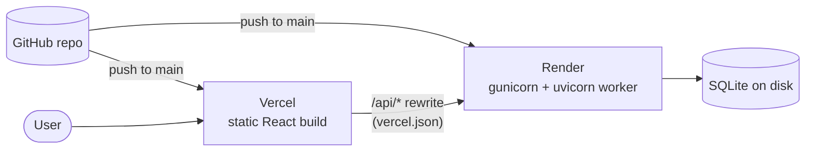

| Part | Platform | Config |
|---|---|---|
| Frontend | Vercel | [`vercel.json`](frontend/vercel.json) rewrites `/api/*` to the Render backend |
| Backend | Render (free plan) | [`render.yaml`](render.yaml), start command `gunicorn -w 1 -k uvicorn.workers.UvicornWorker app.main:app` |

In the Vercel project settings, set **Root Directory** to `frontend`. Render picks up `backend` from `render.yaml` (`rootDir: backend`).

The first request after idle time on the free tier can take 30 to 60 seconds while the service wakes up.

---

## Design Decisions

| Decision | Rationale |
|---|---|
| SQLite instead of PostgreSQL | No setup, which suits a single-instance free-tier deployment |
| Single Gunicorn worker | The model and dependencies are memory-heavy, and more workers exceed free-tier RAM |
| Base64 images in the database | Avoids object storage; acceptable at prototype scale |
| PNG-only uploads | Lossless format keeps thin handwriting strokes intact |
| Client-side ROI crop | The user picks exactly what to analyse, which is more accurate than a full page |
| Template bank plus shape analysis on top of YOLO | A small dataset leaves some classes confusable; cheap classical features add a second opinion |
| Confidence capped at 0.99 | A model should not claim certainty |
| Persistence failures never break a response | History is a convenience, not part of the core result |

---

## Limitations

- Trained on a small dataset, so accuracy depends on how close the handwriting is to it
- Single octave only: upper and lower octave dots are not yet classified
- Assumes dark ink on a light background with reasonable contrast
- Assumes left-to-right reading order
- CORS is open (`*`) and there is no authentication, and scan history is shared by all users of an instance
- `render.yaml` stores the SQLite file on the instance disk, so history may not survive redeploys on the free plan

---

## Roadmap

- [ ] Multi-octave detection (dots above and below swaras)
- [ ] Full-page processing with automatic row segmentation
- [ ] Raga identification from detected sequences
- [ ] MIDI playback of detected notation
- [ ] User accounts with per-user history
- [ ] ONNX export for faster CPU inference
- [ ] Docker image for consistent deployment
- [ ] Annotation tool for user-contributed training data

---

## Tech Stack

| Layer | Technologies |
|---|---|
| Frontend | React 18, TypeScript, Vite 5, TailwindCSS, React Router, react-image-crop, react-webcam, Lucide |
| Backend | FastAPI, Uvicorn, Gunicorn, Python 3.11 |
| ML / CV | YOLOv8 (Ultralytics), PyTorch, OpenCV, Pillow, NumPy |
| Storage | SQLite |
| Hosting | Vercel (frontend), Render (backend) |

---

## License

Open source. See the individual dependency licenses for third-party components.
